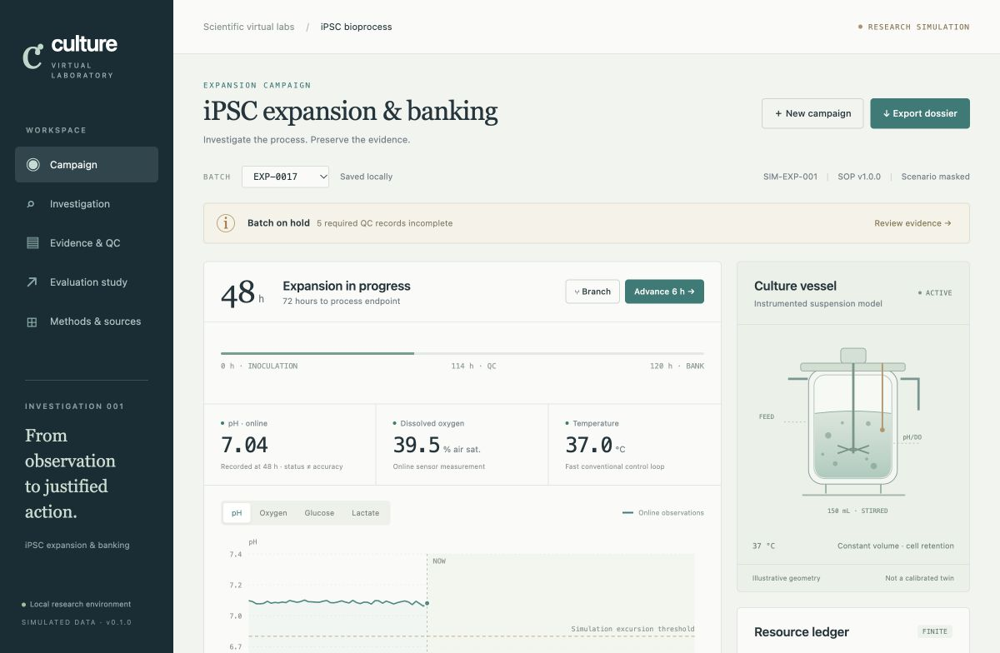

# Culture Lab · iPSC bioprocess investigation

A runnable virtual laboratory for an iPSC expansion-and-banking campaign. Investigate instrument discrepancies, choose measurements, change bounded perfusion settings, and assemble an evidence-linked simulated batch dossier.

**Research status:** all operating histories, faults, and QC results are synthetic. The process model is documented and tested, but has not been calibrated to raw experimental campaign data. This is a research simulator, not an empirically validated digital twin or a real batch-release system.



## Run locally

Requires Python 3.10 or newer and a modern browser. The application has no third-party Python packages, Node build step, model-service credentials, or external frontend dependencies.

```sh
git clone https://github.com/hiddenlif/ipsc-bioreactor-lab.git
cd ipsc-bioreactor-lab
python3 -m ipsc_lab.server --port 8840
```

Open **http://127.0.0.1:8840**. On macOS, `run.command` starts the same server. Stop it with Ctrl+C. Sessions are saved in the ignored `.runtime/` directory and survive server restarts. The server binds to loopback only.

## A complete workflow

1. Start a masked campaign at 48 h after a retained routine warm-up.
2. Request a metabolic panel, independent pH check, or delivery verification. Results arrive after their virtual delay and consume sample volume.
3. Compare explanations, inspect assay validity, and intervene using available evidence. The simulator independently validates action limits and evidence prerequisites.
4. Branch the campaign to explore another action. Each branch has its own state and history.
5. Collect banking QC at or after the illustrative 114 h checkpoint, before the 120 h culture endpoint. Wait for delayed results.
6. Review the complete evidence, record an accept/hold/reject recommendation, and export the dossier or sample CSV.

An invalid result stays in the record. A later passing result does not erase a valid failure. Recovery does not erase historical excursions. The numerical fast control loop and the optional diagnostic rule supervisor are conventional software; the interface does not label them as LLMs.

## Executed investigation

The retained study contains **126 synthetic comparator campaigns**: seven scenarios, six reporting seeds, and three conventional policies. A separate **four-episode Codex pilot records 44 actual decisions** from the development conversation, including measurement selection, evidence-linked interventions, and final recommendations. Fresh replay reproduced all four pilot dossiers exactly.

| Conventional policy | Mean viable yield, million cells | Mean medium, mL | Mean adverse exposure, h | Unsafe simulated accepts / 42 |
|---|---:|---:|---:|---:|
| Fixed schedule | 314.3 | 318.3 | 21.9 | 2 |
| Sampled-glucose feedback | 387.4 | 507.5 | 21.9 | 1 |
| Diagnostic rule supervisor | 434.9 | 532.3 | 2.5 | 1 |

The experiment exposed an evidence-window failure: a valid 114 h QC sample can pass while simulated endpoint viability later falls below the illustrative minimum. Those failures are retained. The pilot collected QC at 118 h, made one hold and three accept recommendations, and agreed with the hidden endpoint screen in its four cases. It also spent more medium than the diagnostic rule comparator. These observations do **not** establish an AI advantage: the developer-model knew the simulator, case count was small, and control policies differed in sampling times and medium use.

Read the [complete investigation and failure analysis](docs/INVESTIGATION.md), [process model](docs/MODEL.md), and [source audit](docs/SOURCE_AUDIT.md).

## Verify and reproduce

```sh
python3 -m unittest discover -s tests -v
python3 scripts/verify_results.py
python3 scripts/reproduce.py --out reports/reproduction-check
```

The reproduction command refuses an existing output directory. It reconstructs all comparator campaigns and replays the recorded model actions; it makes no new model calls. See [reproducibility details](docs/REPRODUCIBILITY.md) and the [completed verification record](docs/VERIFICATION.md).

## Python code quality

```sh
python3 -m pip install -r requirements-dev.txt
ruff check .
ruff format --check .
```

Ruff is pinned to 0.17.2 and configured for Python 3.10+. The [cleanup verification](reports/ruff-cleanup-v1/README.md) records tests, source provenance and scientific replay results.

## Project contents

| Location | Purpose |
|---|---|
| `ipsc_lab/` | Process and measurement model, conventional policies, local HTTP API |
| `web/` | Buildless interactive laboratory interface |
| `config/sop.json` | Versioned illustrative evidence contract |
| `tests/` | Scientific accounting, timing, provenance, action and API checks |
| `reports/comparison-v1/` | Frozen plan, 126 campaign dossiers, metrics and summary |
| `runs/model-pilot-v1/public/` | Actual model observations, actions and rationales |
| `reports/model-pilot-v1/` | Pilot dossiers, unmasked design and matched outcomes |
| `docs/` | Model, source audit, investigation, reproduction and verification records |

The completed development scope is this iPSC laboratory. The spatial tumor laboratory is a separate planned project. The nanobody project is on hold.
